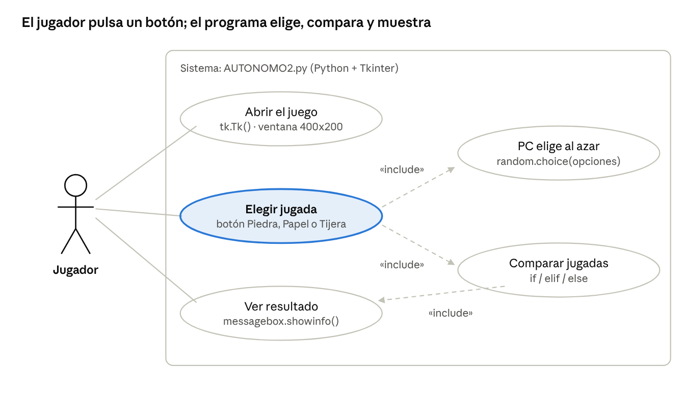
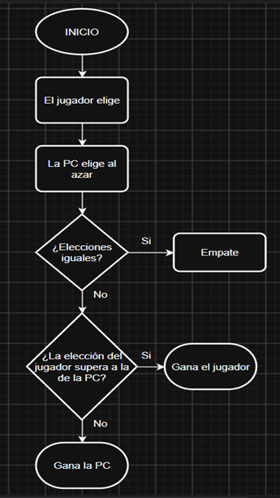
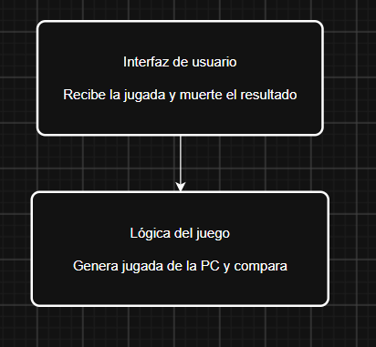

# Nombre del proyecto

Piedra, Papel o Tijera (jugador vs PC) con interfaz gráfica en Python

## Integrantes

- Luis Danilo Criollo Caiza

## Fecha

11/10/2026

## Objetivo del sistema

Desarrollar en Python un juego de Piedra, Papel o Tijera con ventana gráfica (Tkinter), en el que el jugador se enfrenta a la computadora, aplicando condicionales, operadores lógicos, listas y el ciclo de eventos, siguiendo los diagramas diseñados previamente.

## Descripción de funcionalidades

- Al ejecutar el programa se abre una ventana de 400x200 con el título "Piedra, Papel o Tijera".
- El jugador elige su jugada pulsando uno de los tres botones: Piedra, Papel o Tijera.
- La PC elige su jugada al azar desde una lista con `random.choice()`.
- El sistema compara las jugadas con `if`, `elif` y `else`:
  - Si son iguales: **Empate**.
  - Si piedra vence a tijera, papel vence a piedra o tijera vence a papel: **Gana el jugador**.
  - En cualquier otro caso: **Gana la PC**.
- Un cuadro de mensaje (`messagebox`) muestra lo que eligió cada uno y el resultado.
- La ventana sigue abierta con `mainloop()`, así que se puede jugar otra ronda pulsando otro botón.

## Cómo ejecutarlo

1. Tener instalado Python 3 (Tkinter ya viene incluido).
2. Descargar el archivo `AUTONOMO2.py`.
3. Ejecutar en la terminal: `python AUTONOMO2.py`

## Diagramas

### Diagrama de casos de uso (funcionalidad)

### Diagrama de flujo (funcionalidad)

### Diagrama de arquitectura en capas

- **Interfaz de usuario:** ventana, botones y mensaje de resultado (Tkinter).
- **Lógica del juego:** función `jugar()`, que genera la jugada de la PC y compara.
